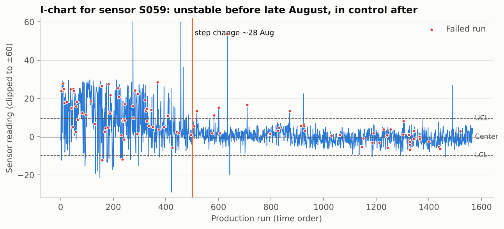
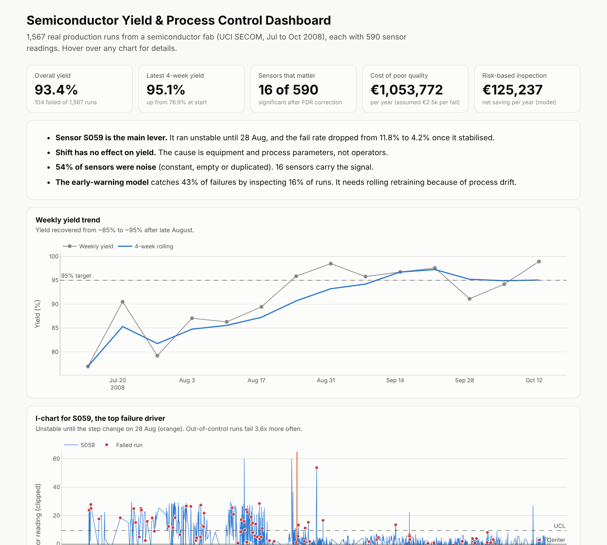

# Semiconductor Wafer Yield & Process Control Analytics

**Finding the process signals behind yield loss in a real semiconductor fab, and putting a euro value on fixing them.**


**[Live interactive dashboard](https://ahmaduzzam31.github.io/semiconductor-yield-analytics/)** ·
**[Full analysis notebook](notebooks/yield_analysis.ipynb)** ·
**[Executive summary](reports/executive_summary.md)**

---

## Business problem
A fab line runs at **93.4% yield**. Each failed production run means scrap, rework and lost tool time,
about **€1.05M a year** in cost of poor quality under the stated assumptions. Engineering had 590 sensor feeds and
no clear view of which ones matter. The questions:

1. Which process signals separate good runs from failed runs?
2. Are failures caused by people (shifts) or by equipment and process?
3. Can at-risk runs be flagged early, and is it worth the inspection cost?

## Key results

| | Finding |
|---|---|
| 🎯 **Root cause** | Sensor **S059** was unstable until 28 Aug. After it stabilised, the fail rate fell from **11.8% to 4.2%**. Out-of-control runs fail **3.6x** more often. |
| 👷 **People vs equipment** | No difference between shifts (chi-square **p = 0.88**), so the cause is equipment and process, not operators. |
| 🔎 **Signal vs noise** | **54%** of the 590 sensors were constant, empty or duplicates. Only **16** are significant after FDR correction. |
| 🤖 **Early warning** | Random forest: CV ROC AUC **0.74**, PR AUC **0.26** (random = 0.07). Inspecting the riskiest **16%** of runs catches **43%** of failures. |
| 💶 **Business case** | About **€125k/year** net saving from risk-based inspection. Each +1pp of yield is worth about **€159k/year**. |
| ⚠️ **Honest caveat** | On a strict forward-in-time test the model falls to random because of **process drift**, so deploy it with rolling retraining. |



## Dashboard preview


## Approach

| Step | What I did | Skills shown |
|---|---|---|
| 1. Data quality audit | Profiled 590 sensors. Dropped 32 mostly-empty, 116 constant and 173 redundant (\|r\| > 0.95). Median imputation. | Data cleaning, data profiling |
| 2. KPI analysis in SQL | Yield KPIs, weekly trend with rolling window, shift comparison, failure streaks (gaps-and-islands), MTBF with `LAG()` | SQL: CTEs, window functions |
| 3. Root-cause screening | Mann-Whitney U per sensor, rank-biserial effect size, Benjamini-Hochberg FDR correction | Hypothesis testing, multiple testing |
| 4. Process control | Individuals control chart (I-MR σ), regime comparison, process-window (decile) analysis | SPC, manufacturing domain |
| 5. Predictive model | Stratified 5-fold CV with **in-fold feature selection** (no leakage), class weighting, PR AUC, capture curve | Machine learning, evaluation |
| 6. Drift check | Forward-in-time validation and KS tests on key sensors | Model risk awareness |
| 7. Business case | Cost of poor quality, inspection ROI curve, recommendations with owners | Business analysis, communication |

## Repository structure
```
├── data/
│   ├── raw/                  # original UCI SECOM files
│   └── processed/            # wafers.csv (one row per run), sensors_clean.csv
├── sql/                      # 5 KPI queries (DuckDB / ANSI SQL)
├── notebooks/
│   └── yield_analysis.ipynb  # full analysis with outputs
├── src/
│   ├── prepare_data.py       # data audit + cleaning pipeline
│   ├── build_dashboard.py    # interactive dashboard -> docs/index.html
│   └── style.py, dashboard_kit.py
├── reports/
│   ├── executive_summary.md  # one-page summary for management
│   ├── data_quality_report.csv, sensor_screening_results.csv, business_case.csv
│   └── figures/
└── docs/index.html           # dashboard (served by GitHub Pages)
```

## Reproduce
```bash
pip install -r requirements.txt
./run_all.sh
```

## Sample SQL: finding failure clusters (gaps-and-islands)
```sql
WITH seq AS (
    SELECT run_id, timestamp, is_fail,
           run_id - ROW_NUMBER() OVER (PARTITION BY is_fail ORDER BY run_id) AS island
    FROM wafers
)
SELECT COUNT(*) AS consecutive_fails, MIN(timestamp) AS started_at
FROM seq WHERE is_fail = 1
GROUP BY island HAVING COUNT(*) >= 2
ORDER BY consecutive_fails DESC;
```

## Assumptions and limitations
- **Costs are illustrative:** €2,500 per failed run, €150 per extra inspection, 60% of failure cost avoided when caught early. All are set in one cell of the notebook.
- Sensor names are anonymised in the source data, so findings tell engineers *where* to look, not the physical mechanism.
- 104 failures is a small sample, so model metrics carry real uncertainty (fold standard deviations are reported).

## Why this project
I studied Electronics & Communication Engineering before moving into business analysis. This project combines
both: semiconductor process knowledge (SPC, yield, sensor data) with the analyst's job of turning data into a
decision and a business case.

**Data source:** [UCI Machine Learning Repository: SECOM](https://archive.ics.uci.edu/dataset/179/secom) (McCann & Johnston, 2008), CC BY 4.0.
